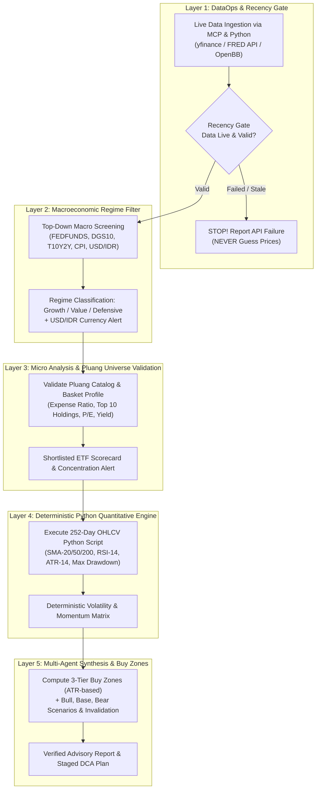

# Financial Market & ETF Quantitative Intelligence
## Anti-Vibe Framework for Equities, US ETFs (Pluang Catalog), & Macroeconomic Analysis

Definitive knowledge standard for **Gemi** to analyze capital markets, macroeconomic regimes, and deliver objective, deterministic investment advisory and volatility-based buy zones for US ETFs (specifically within the **Pluang** catalog) with zero hallucination.

---

## 1. Core Philosophy & Fundamental Axioms

### 1.1. The FinRobot Principle
> **"Models reason, software computes, agents orchestrate, and systems verify."**  
> *(AI4Finance-Foundation / FinRobot)*

Large Language Models (LLMs) are **NEVER** designed to serve as real-time market price databases or probabilistic financial calculators. In the financial domain:
1. **The LLM's Role** is strictly context comprehension, portfolio objective alignment, hypothesis generation, and qualitative reasoning.
2. **Deterministic Software (Python / MCP)** executes live data ingestion and precision mathematical time-series calculations (SMA, RSI, ATR, Max Drawdown).
3. **The System / Risk Gate** verifies data recency (*Recency Gate*) and enforces fiduciary risk boundaries before presenting outputs to the user.

### 1.2. The 4 Pathologies of AI Financial Hallucination
AI coding agents frequently generate invalid or stale financial outputs due to 4 architectural flaws:
1. **Lack of Real-Time Data Grounding:** The model quotes prices, yields, or P/E ratios from static pre-training memory.
2. **Arithmetic & Indicator Hallucination:** The model guesses Moving Averages or RSI probabilistically via prose rather than executing mathematical time-series code.
3. **False Precision Bias:** Declaring a single absolute price target without modeling volatility distributions, probabilistic bands, or downside scenarios.
4. **Currency Blindness (Critical for Indonesian / Pluang Investors):** Ignoring USD/IDR exchange rate dynamics, exposing investors to double-whammy losses (gains in nominal USD offset by currency depreciation or vice versa).

---

## 2. 5-Stage Deterministic Anti-Hallucination Pipeline



---

## 3. Tooling Ecosystem & MCP Server Integrations

To ensure fresh data ingestion and exact mathematical precision, leverage the following MCP servers and tools:

| Category | MCP Package / Server | Core Capabilities | Data Source |
| :--- | :--- | :--- | :--- |
| **Live Market Data** | `yahoo-finance-mcp` (or Python `yfinance`) | Live/previous close prices, 252-day OHLCV, ETF holdings, dividend yields, `USDIDR=X` exchange rates. | Yahoo Finance API |
| **Macroeconomics** | `fred-mcp-server` / `mcp-fred` | Fed Funds rate, Treasury yields, CPI/PCE inflation, unemployment, GDP. | Federal Reserve Bank of St. Louis (`fred.stlouisfed.org`) |
| **Multi-Asset Analytics** | `openbb-mcp-server` / `OpenBB` | Comprehensive ETF screening, fundamental basket reports, valuation spreads. | OpenBB Platform |
| **Quantitative Agents** | `finance-trading-ai-agents-mcp` | Algorithmic trade patterns, backtesting, portfolio simulation. | Open-Source Trading Agents |
| **Execution Engine** | Local Python Subprocess | Deterministic execution of `pandas`, `numpy`, `pandas_ta`, `PyPortfolioOpt`. | Local Python Runtime |

---

## 4. Benchmark Repositories & Architectural Frameworks

1. **`virattt/ai-hedge-fund` (64k+ GitHub Stars):**
   - *Multi-Agent Architecture*: Splits decision logic into autonomous specialist roles:
     - **Fundamentals Agent**: Analyzes basket accounting ratios and expense structures.
     - **Technicals Agent**: Evaluates moving average slopes, RSI momentum, and ATR bands.
     - **Valuation Agent**: Assesses historical valuation multiples vs current pricing.
     - **Sentiment Agent**: Tracks news cycles and macro releases.
     - **Risk Manager**: Holds **absolute veto authority** to void or resize positions when volatility exceeds risk limits.
     - **Portfolio Manager**: Aggregates multi-agent signals into capital allocation recommendations.
2. **`AI4Finance-Foundation/FinRobot`:**
   - *Financial Chain-of-Thought (Financial CoT)*: Deconstructs investment theses into auditable data-backed steps.
   - *Strict Separation of Concerns*: Isolates DataOps ingestion layers from model reasoning blocks.
3. **`alirezarezvani/claude-skills` (`finance/skills/stock-analysis/SKILL.md`):**
   - **Recency Gate Standard**: Mandatory timestamp validation before initializing analysis.
   - *Data Integrity Verification*: Validates cross-source metric consistency via Python scripts.
4. **`borghei/claude-skills` (`finance/financial-analyst/SKILL.md`):**
   - **Anti-False Precision Standard**: Prohibits single speculative target prices; requires 3-tier volatility ranges (*Base, Bull, Bear cases*) and thesis invalidation levels.
5. **`wilsonfreitas/awesome-quant`:**
   - Curated quantitative finance libraries: `pandas-ta`, `vectorbt`, `PyPortfolioOpt`, `quantstats`, and `yfinance`.

---

## 5. 3-Layer Analytical Framework (Macro, Micro, Quant)

Unlike single-stock equities dependent on individual corporate earnings, an ETF (*Exchange-Traded Fund*) represents a basket of securities. Analysis must execute top-down:

### Layer 1: Macroeconomic Regime Filter (Top-Down Screening)
Query FRED indicators to identify macroeconomic conditions before sector selection:

1. **Monetary Policy & Yield Curves:**
   - FRED Tickers: `FEDFUNDS` (Effective Federal Funds Rate), `DGS10` (10-Year Treasury Yield), `T10Y2Y` (10Y minus 2Y Yield Spread).
   - **Mechanism**: When 10-year Treasury yields rise sharply, long-duration growth and technology ETFs (`QQQ`, `SMH`) experience multiple contraction due to higher discount rates. Conversely, value, high-dividend, and financial ETFs (`SCHD`, `XLF`) exhibit defensive resilience.
   - Yield curve inversion (`T10Y2Y < 0`) and un-inversion phases signal business cycle inflection and potential recession risks.
2. **Inflation & Economic Growth:**
   - FRED Tickers: `CPIAUCSL` (CPI Inflation), `PCEPI` (Personal Consumption Expenditures), `UNRATE` (Unemployment Rate), `GDPC1` (Real GDP).
   - **Expansion Phase** (Rising GDP, stable inflation): Overweight broad-market equity indices (`VOO`, `VTI`) and aggressive tech sectors (`QQQ`, `XLK`, `SMH`).
   - **Slowdown / Recession Phase** (Slowing growth, rising unemployment): Rotate to defensive sectors (`XLV` Healthcare, `XLP` Consumer Staples), high-quality dividends (`SCHD`), gold (`GLD`), or long-term Treasuries (`TLT`).
3. **USD/IDR Currency Dynamics (Pluang Catalog Specific):**
   - Yahoo Finance Ticker: `USDIDR=X`.
   - Because Indonesian investors on Pluang convert IDR to USD for US ETF exposure, currency levels are paramount:
     - When USD/IDR trades at historical highs (severely depreciated Rupiah), avoid large lump-sum allocations to mitigate double-whammy losses upon eventual currency normalization.
     - Mandatory guideline: Recommend disciplined **Dollar Cost Averaging (DCA)** across multiple tranches.

---

### Layer 2: Micro Structure & Pluang Catalog Screening
The Pluang ecosystem provides access to over 50 US ETFs. Micro basket analysis evaluates:

1. **Expense Ratio:**
   - Passive Core Index (`VOO`, `VTI`, `SPY`): Target $\le 0.03\% - 0.10\%$.
   - Sectoral & Thematic (`SMH`, `XLK`, `XLF`): Target $\le 0.40\% - 0.50\%$.
   - High expense ratios without verified persistent alpha are excluded.
2. **Concentration Risk & Top 10 Holdings:**
   - Audit weighting of the top 10 component assets.
   - *Critical Scenario*: On thematic technology ETFs like `QQQ` or `SMH`, the top 3 holdings (e.g., Nvidia, Apple, Microsoft, TSMC) frequently command $\ge 40-45\%$ of total fund capital.
   - When concentration is extreme, agents **must** append earnings announcement dates for dominant holdings, as single-stock earnings drive total basket volatility.
3. **Basket Valuation Multiples:**
   - Evaluate the ETF's current *Weighted Average P/E Ratio* against its 5-year historical median.
   - Evaluate *Dividend Yield* for income-oriented funds (`SCHD`, `JEPI`).

---

### Layer 3: Deterministic Volatility Buy Zones (Python Mathematical Engine)
Never forecast future prices probabilistically through prose. Execute deterministic volatility formulas:

#### 1. Long-Term Trend Regime Filter
Compare last closing price ($P_{\text{close}}$) with $\text{SMA}_{50}$ and $\text{SMA}_{200}$:
$$\text{Trend Regime} = \begin{cases} \text{Bullish (Buy on Pullback)}, & \text{if } P_{\text{close}} > \text{SMA}_{200} \text{ and } \text{SMA}_{50} > \text{SMA}_{200} \\ \text{Consolidation / Rangebound}, & \text{if } P_{\text{close}} \approx \text{SMA}_{200} \\ \text{Bearish (Defensive / Deep Value)}, & \text{if } P_{\text{close}} < \text{SMA}_{200} \end{cases}$$

#### 2. Average True Range ($\text{ATR}_{14}$)
- $\text{ATR}_{14}$ measures typical asset movement over the preceding 14 trading days, filtering out intraday market noise.

#### 3. 3-Tier Volatility-Based Buy Zones
```
Current Price (P_close)
│
├── [Tier 1: Light Tranche / Momentum Pullback]
│   Support_1 = min(SMA_20, P_close - 1.0 * ATR_14)
│   Condition: Minor pullback in strong uptrend (RSI 45 - 55).
│
├── [Tier 2: Core Accumulation / Mean Reversion Zone]
│   Support_2 = SMA_50 or Lower Bollinger Band (20, 2)
│   or: P_close - 2.0 * ATR_14
│   Condition: Healthy correction toward quarterly average (RSI 35 - 45).
│
└── [Tier 3: Deep Discount / Major Historical Support]
    Support_3 = SMA_200 Area
    Condition: Deep market pullback / oversold capitulation (RSI < 35).
```

---

## 6. Investment Scenarios & Invalidation Levels

Every recommendation must present 3 structured scenarios:

1. **Base Case (Highest Probability):** Moderate trend continuation assuming consensus macro variables and corporate earnings trajectories.
2. **Bull Case (Optimistic Catalyst):** Macro acceleration, accelerated rate cuts, or sector productivity surges driving multiple expansion.
3. **Bear Case (Downside Risk):** Macro deterioration, persistent inflation, or margin compression across component stocks.
4. **Thesis Invalidation Level:**
   - Technical breakdown below key moving averages (e.g., high-volume breakdown below $\text{SMA}_{200}$).
   - Structural macroeconomic shifts (e.g., hawkish Federal Reserve rate hikes resumption).

---

## 7. Popular Pluang US ETF Universe Catalog

| Category | Ticker | Fund Name & Benchmark | Core Characteristics |
| :--- | :--- | :--- | :--- |
| **US Broad Market** | `VOO` / `SPY` | Vanguard S&P 500 ETF / SPDR S&P 500 | Core institutional portfolio anchor, 500 largest US firms, ultra-low expense ratio (VOO 0.03%). |
| **US Total Market** | `VTI` | Vanguard Total Stock Market ETF | Full market cap spectrum (large, mid, small cap coverage). |
| **Tech & Growth** | `QQQ` | Invesco QQQ Trust (Nasdaq-100) | High growth, technology-dominated, sensitive to Treasury yields. |
| **Semiconductors** | `SMH` | VanEck Semiconductor ETF | High beta, cyclical, concentrated exposure to Nvidia & TSMC. |
| **Quality Dividend** | `SCHD` | Schwab U.S. Dividend Equity ETF | Value-oriented consistent dividend payers, lower volatility, inflation hedge. |
| **Dividend & Options** | `JEPI` | JPMorgan Equity Premium Income ETF | High monthly income via covered call overlay, moderate capital upside. |
| **Financial Sector** | `XLF` | Financial Select Sector SPDR Fund | US commercial and investment banks, sensitive to yield curve spread. |
| **Healthcare** | `XLV` | Health Care Select Sector SPDR Fund | Classic defensive sector, resilient demand across economic cycles. |
| **Consumer Staples** | `XLP` | Consumer Staples Select Sector SPDR | Everyday consumer essentials, defensive during recessionary periods. |
| **Physical Gold** | `GLD` / `IAU` | SPDR Gold Shares / iShares Gold Trust | Inflation hedge, geopolitical safe-haven, currency debasement defense. |
| **US Treasuries** | `TLT` | iShares 20+ Year Treasury Bond ETF | Long-duration US sovereign bonds, high sensitivity to Fed interest rate cuts. |

---

## 8. Deterministic Quantitative Python Analysis Script

Execute the following Python script when auditing ETF tickers:

```python
import yfinance as yf
import pandas as pd
import numpy as np
import datetime
import json

def analyze_etf(ticker_symbol: str) -> dict:
    ticker = yf.Ticker(ticker_symbol)
    
    # 1. Recency Gate & Live Price
    fast_info = ticker.fast_info
    current_price = fast_info.last_price or fast_info.previous_close
    
    # 2. Historical Data (1 Year / 252 Trading Days)
    hist = ticker.history(period="1y")
    if hist.empty or len(hist) < 50:
        raise ValueError(f"Insufficient historical data for ticker {ticker_symbol}")
    
    close = hist['Close']
    high = hist['High']
    low = hist['Low']
    
    # 3. Moving Averages
    sma_20 = close.rolling(window=20).mean().iloc[-1]
    sma_50 = close.rolling(window=50).mean().iloc[-1]
    sma_200 = close.rolling(window=200).mean().iloc[-1] if len(close) >= 200 else None
    
    # 4. RSI (14-Day)
    delta = close.diff()
    gain = (delta.where(delta > 0, 0)).rolling(window=14).mean()
    loss = (-delta.where(delta < 0, 0)).rolling(window=14).mean()
    rs = gain / loss
    rsi_14 = 100 - (100 / (1 + rs)).iloc[-1]
    
    # 5. ATR (14-Day)
    tr1 = high - low
    tr2 = (high - close.shift()).abs()
    tr3 = (low - close.shift()).abs()
    tr = pd.concat([tr1, tr2, tr3], axis=1).max(axis=1)
    atr_14 = tr.rolling(window=14).mean().iloc[-1]
    
    # 6. Drawdown & Volatility
    high_52w = close.max()
    low_52w = close.min()
    pct_from_52w_high = ((current_price - high_52w) / high_52w) * 100
    
    rolling_max = close.cummax()
    daily_drawdown = (close - rolling_max) / rolling_max
    max_drawdown_1y = daily_drawdown.min() * 100
    
    daily_returns = close.pct_change().dropna()
    annualized_volatility = daily_returns.std() * np.sqrt(252) * 100
    
    # 7. USD/IDR Exchange Rate
    usdidr = yf.Ticker("USDIDR=X").fast_info.last_price or 16000.0
    
    # 8. 3-Tier Buy Zones
    tier_1_buy = min(sma_20, current_price - (1.0 * atr_14))
    tier_2_buy = sma_50 if sma_50 else (current_price - (2.0 * atr_14))
    tier_3_buy = sma_200 if sma_200 else (current_price - (3.0 * atr_14))
    
    return {
        "ticker": ticker_symbol,
        "timestamp_utc": datetime.datetime.utcnow().isoformat(),
        "current_price_usd": round(current_price, 2),
        "current_price_idr": round(current_price * usdidr, 0),
        "usdidr_rate": round(usdidr, 2),
        "52w_high_usd": round(high_52w, 2),
        "pct_from_52w_high": round(pct_from_52w_high, 2),
        "sma_20": round(sma_20, 2),
        "sma_50": round(sma_50, 2),
        "sma_200": round(sma_200, 2) if sma_200 else None,
        "rsi_14": round(rsi_14, 2),
        "atr_14": round(atr_14, 2),
        "annualized_volatility_pct": round(annualized_volatility, 2),
        "max_drawdown_1y_pct": round(max_drawdown_1y, 2),
        "buy_zones": {
            "tier_1_shallow_pullback": round(tier_1_buy, 2),
            "tier_2_ideal_mean_reversion": round(tier_2_buy, 2),
            "tier_3_deep_discount_support": round(tier_3_buy, 2)
        }
    }
```

