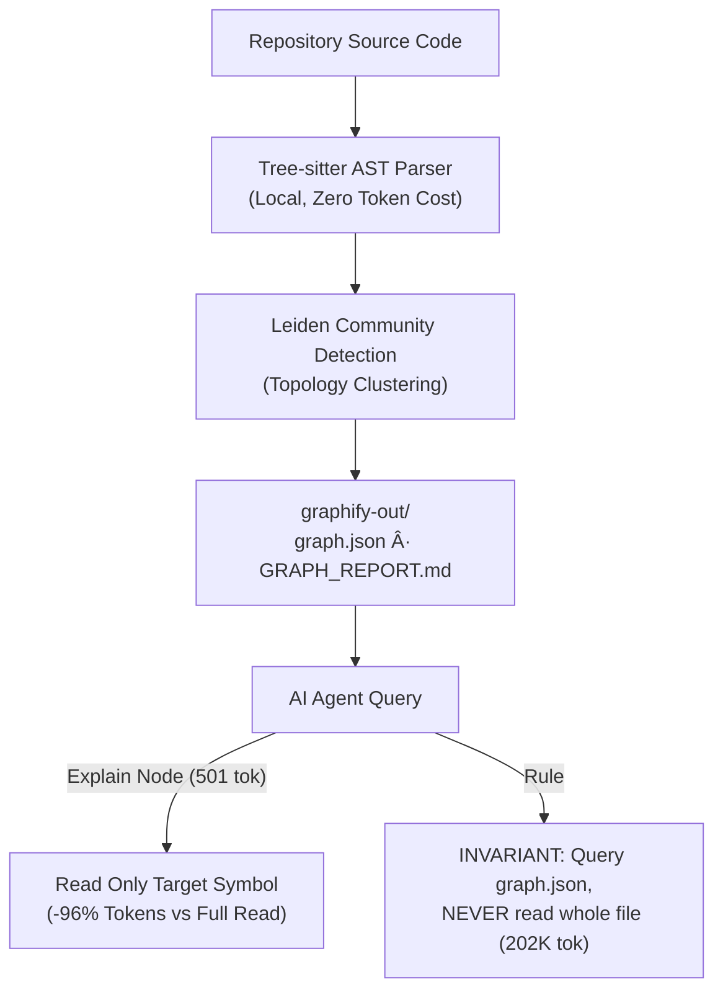
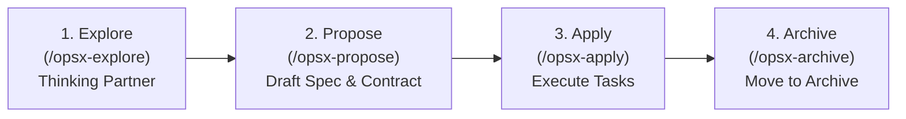

# Spec-Driven Development, RTK Token Compression & Graphify AST Navigation

> **Primary Source Reference:** BRILiaN Way Arcade Sharing Session (`bw-games`)  
> **Reference Repository:** [sudnanidref/bw-games](https://github.com/sudnanidref/bw-games)  
> **Core Objective:** "Fewer tokens, same answers." Achieving maximum agent reasoning intelligence while slashing token consumption by 60%–98% through Spec-Driven Development, command-output filtering (RTK), and AST knowledge graph navigation (Graphify).

---

## 1. The Token Limitation Dilemma & The "Fewer Tokens, Same Answers" Paradigm

Fast, high-capacity models like Gemini 3.8 Flash (High) have massive raw context windows, but in real-world multi-feature engineering projects, unconstrained token consumption introduces three severe failure modes:
1. **Context Window Inflation & Token Burn:** Passing massive raw directory trees (`ls -la`), verbose package manager logs, and full-file dumps exhausts token budgets rapidly.
2. **Lost-in-the-Middle Cognitive Degradation:** As context balloons beyond hundreds of thousands of tokens, models suffer from attentional attenuation on critical project constraints and invariants.
3. **Spec Drift & Scope Sprawl:** Agents without strict scope boundaries wander into unrelated directories, refactoring code outside the blast radius and introducing regressions.

```
┌────────────────────────────────────────────────────────────────────────┐
│                   TOKEN EFFICIENCY SAVINGS COMPARISON                  │
├──────────────────────────┬──────────────────────┬──────────────────────┤
│ Operation                │ Standard Unscoped    │ Compressed / Graph   │
├──────────────────────────┼──────────────────────┼──────────────────────┤
│ Directory Listing        │ `ls src` (2,460 tok) │ `rtk ls` (40 tok)    │
│                          │                      │ ➔ -98% reduction     │
├──────────────────────────┼──────────────────────┼──────────────────────┤
│ Git History              │ `git log`            │ Compact Git Log      │
│                          │                      │ ➔ -52% reduction     │
├──────────────────────────┼──────────────────────┼──────────────────────┤
│ Test Execution           │ `npm test`           │ Filtered Test Output │
│                          │                      │ ➔ -15% reduction     │
├──────────────────────────┼──────────────────────┼──────────────────────┤
│ Module Exploration       │ `read integrity/`    │ Explain 1 Graph Node │
│                          │ (14,367 tok)         │ (501 tok)            │
│                          │                      │ ➔ -96% reduction     │
└──────────────────────────┴──────────────────────┴──────────────────────┘
```

---

## 2. RTK (Rust Token Killer) Command Output Compression

RTK acts as an intelligent proxy wrapper between agent tool execution and raw terminal output, stripping out formatting boilerplate, spinners, progress bars, and redundant successful traces.

### 2.1. Core RTK Operations
* `rtk ls <path>`: Produces a compact, structured directory summary. Automatically ignores noisy build and dependency trees (`node_modules`, `.git`, `dist`, `__pycache__`) and aggregates file counts with byte sizes.
* `rtk read <file>`: Performs signature-aware file inspection, extracting exported types, interfaces, and function signatures without dumping hundreds of lines of implementation logic.
* `rtk err <cmd>`: Wraps build and test commands to isolate **only errors and failure stack traces**, completely suppressing thousands of lines of passing log noise.
* `rtk log <file>`: Emits deduplicated log output with occurrence counts (`[x42] Connection timeout`).
* `rtk json <file>`: Emits JSON structural schema without dumping megabytes of payload values.
* `rtk find <pattern>`: Targeted symbol discovery across the workspace.

---

## 3. Graphify: AST Knowledge Graph & Leiden Community Navigation

Graphify parses source code into an Abstract Syntax Tree (AST) using local Tree-sitter parsers and groups interconnected components using **Leiden community detection** into `graphify-out/graph.json` and `GRAPH_REPORT.md`.



### 3.1. Key Graph Navigation Elements
1. **Community Hubs:** High-level navigation entry points categorizing modules by architectural cluster (e.g. `IntegrityGame`, `Kasir Sat Set`, `BlindBuilder`).
2. **God Nodes:** The most heavily connected core abstractions (e.g., `vitest` with 32 edges, `IntegrityGame()` with 29 edges). Identifying god nodes immediately exposes architectural coupling.
3. **Surprising Connections:** Non-obvious call paths and cross-boundary dependencies discovered by static AST extraction (e.g., `createApp()` calling `outcomeMatchesSource()`).
4. **Hyperedges:** Multi-node relationship flows representing complete business journeys (e.g., BRILiaN Way Five-Value Journey connecting `contract.ts`, individual stage mini-games, and score normalization).

### 3.2. The Golden Rule of Graphify
> **INVARIANT:** Never read `graph.json` in its entirety (often 200,000+ tokens). Always query specific nodes, edges, and community clusters using targeted scripts or JSON filters.

---

## 4. Spec-Driven Development (OpenSpec Architecture)

"Spec first. Code second." Instead of writing premature code and drowning in review diffs, work is deconstructed into a four-stage lifecycle.



### 4.1. The 4-Stage Lifecycle
1. **Explore (`/opsx-explore`):**
   - Pure thinking and discovery mode.
   - Grounded in existing codebase patterns.
   - Prohibited from mutating application source code.
2. **Propose (`/opsx-propose`):**
   - Formulates the change specification under `openspec/changes/<change-name>/`:
     * `proposal.md`: Why the change is needed and what changes.
     * `design.md`: Technical architecture and boundary definitions.
     * `specs/`: Detailed functional criteria.
     * `tasks.md`: Sequenced checklist of atomic, verifiable work items.
3. **Apply (`/opsx-apply`):**
   - Bottom-up execution strictly following `tasks.md`.
   - Executes one task at a time, verifying with tests before moving forward.
4. **Archive (`/opsx-archive`):**
   - Once all tasks pass verification, the change is moved to `openspec/changes/archive/YYYY-MM-DD-<change-name>/`.
   - **Crucial Benefit:** Keeps active context minimal, preventing obsolete specifications from cluttering future sessions.

### 4.2. Boundaries First & Strict Seams
- **Contract-First:** Before building components, define the shared interface (e.g. `src/games/contract.ts` with `onComplete({ valueId, score })`, `onCancel()`, `onError(error)`). The shell owns the routing; components only plug into the contract.
- **Scope Lines for Agents ("Agents Stay in Their Folder"):** Each agent or subtask is strictly confined to its designated directory (e.g., `src/games/integrity/`). Touching files outside the assigned folder is strictly forbidden without explicit authorization.

---

## 5. Lessons Learned: When Specs Help vs. When They Hurt

| Domain | Where Specs Paid Off (Keep) | Where Specs Slowed Us (Change) |
|---|---|---|
| **Architecture** | **Many owners, one contract:** Multiple independent developers/agents built separate games that plugged seamlessly into the shell. | **Spec drift after decisions:** During implementation, decisions shift. Solution: **"Write decisions back"** immediately to keep specs truthful. |
| **Testing** | **Rules become unit tests:** Spec acceptance criteria translate 1:1 into deterministic tests (`scoring.test.ts`, `engine.test.ts`). | **Overhead on tiny tweaks:** Giant spec ceremonies for 2-line bug fixes. Solution: **"Right-size the ceremony"** proportionally. |
| **Code Review** | **Review intent, not diffs:** Reviewing `proposal.md` and `tasks.md` takes 2 minutes; reviewing 3,000 lines of generated code takes hours. | **Specs not archived:** Leaving old completed changes in the active directory confuses agents. Solution: **"Archive as you go"**. |
| **UX & Polish** | **Spec the seams first:** Defining inputs/outputs early unblocks parallel work. | **"Game feel is not a spec":** Visual timing, animations, and tactile feel cannot be perfectly captured in text. Solution: **Spec the behavior; tune the feel by playing/running.** |

---

## 6. Integration into Gemi's Operating Discipline

Gemi applies these principles across every coding task:
1. **Contract-First:** Define schemas and interfaces before writing implementation.
2. **Compact Command Output:** Filter terminal stdout/stderr to eliminate token waste.
3. **Graph-First Reconnaissance:** Query AST relationships and symbol exports before opening large files.
4. **Scoped Blast Radius:** Keep modifications strictly contained within the targeted module directory.
5. **Archive as You Go:** Retain only active work in immediate memory, archiving completed milestones to Engram or archive directories.

