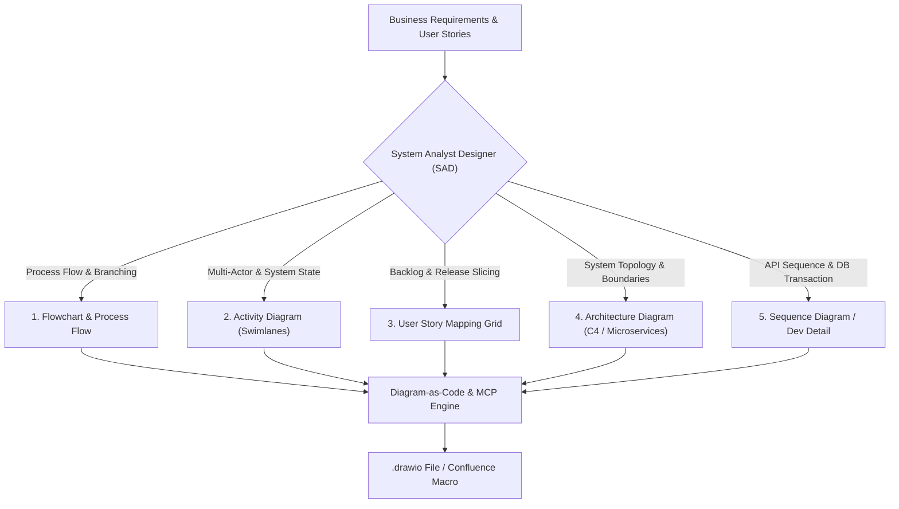
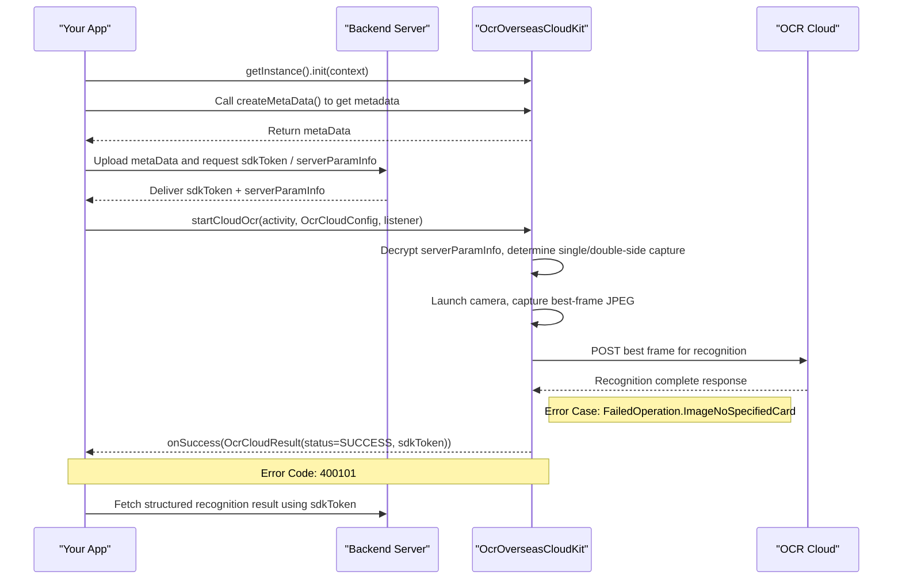

# System Analyst Designer (SAD) Diagramming & Diagram-as-Code (DaC) Architecture

## 1. Core Mental Model: System Analyst Designer (SAD) in Banking & Microservices

As a **System Analyst Designer (SAD)**, the core responsibility is bridging the business domain (Product Managers, Business Owners, Compliance, Fraud, Security) with technical implementation realities (Backend Engineers, Mobile/Frontend Engineers, DevOps, QA, DBA).

Diagrams and specifications produced by a System Analyst Designer are not passive visual illustrations; they are **System Specification Contracts** governing test criteria, architectural boundaries, and operational risk mitigation.

### 1.1. Fundamental Failure Modes of LLMs with Raw `.drawio` (XML mxGraphModel)
When LLMs attempt to generate raw Draw.io XML (`<mxGraphModel>`), common failure patterns emerge:
1. **Coordinate Hallucination:** Lacking 2D spatial awareness, AI randomly guesses geometry coordinates (`x`, `y`, `width`, `height`), resulting in overlapping nodes, clipped text, and illegible canvases.
2. **Edge Routing Chaos:** Connectors slice through intermediate boxes diagonally, anchor points miss shape boundaries, and routing lacks orthogonal discipline.
3. **XML Syntax Fragility:** Broken closing tags or unescaped entities (`&quot;`, `&lt;`, `&gt;`) corrupt Draw.io parsing and break Confluence page rendering.

### 1.2. Strategic Architecture: Diagram-as-Code (DaC) & Declarative Layout
To produce deterministic, enterprise-grade diagrams programmatically, Gemi enforces a **Diagram-as-Code (DaC)** lifecycle:
1. **Phase 1 (Declarative Specification First):** Formulate logic, state transitions, and swimlanes using declarative languages like **Mermaid.js**, **PlantUML**, or **Structurizr DSL** to validate flows with stakeholders.
2. **Phase 2 (Programmatic Layout Engine):** Utilize code-based toolkits (Python scripts like `drawpyo`, `mingrammer/diagrams`, or Draw.io MCP tools) to compute geometry, margins, grid alignment, and orthogonal routing mathematically.
3. **Phase 3 (Confluence Macro & Storage Integration):** Store diagrams as `.drawio` / `.drawio.xml` files following squad naming conventions and embed them via Confluence Draw.io Macros (`<ac:structured-macro ac:name="drawio">`), preserving revision history and editable vectors.

---

## 2. Taxonomy & Standards for the 5 System Analyst Diagram Types



### 2.1. Flowchart & Business Process Flow
- **Purpose:** Map business decision trees and error recovery sequentially from entry trigger to terminal states.
- **Component Primitives:**
  - *Start / Entry Point:* Rounded Pill (Green `#d5e8d4`).
  - *Process Step:* Rounded Rectangle (Blue `#dae8fc`).
  - *Decision Node:* Rhombus (Yellow/Gold `#fff2cc`) with explicit branch labels (`Yes`/`No`, `Valid`/`Invalid`).
  - *Sub-process / Service Call:* Box with dual border or service badge.
  - *End / Terminal State:* Success (Green `#d5e8d4`) or Error/Exit (Red `#f8cecc`).
- **Ergonomic Invariant:** Primary happy paths progress vertically (Top-to-Bottom) or horizontally (Left-to-Right). Exception and error flows branch outward to the right or bottom.

### 2.2. Activity Diagram (Swimlanes / Responsibility Partitions)
- **Purpose:** Detail cross-system orchestration across distinct security and technical boundaries (critical for onboarding, migration, and authentication flows).
- **Standard 5 Banking Swimlanes (BRImo / Qita):**
  1. `User / Customer`: Physical client interactions (app open, OTP input, biometric capture, KTP photo).
  2. `Frontend (iOS / Android / Web)`: Client validation, payload encryption, request debouncing, API Gateway dispatch.
  3. `API Gateway (Erangel)`: Routing, session validation, rate limiting, request aggregation.
  4. `Core Microservices (Ladrillera / Vikendi / Livik / Hotspring)`: State machine validation, transactional writes, credential verification, audit logging.
  5. `External / Third Parties (Dukcapil / Privy / Vida / Zoloz / ESB CASA / Kafka)`: Identity verification, biometric liveness, digital signatures, async event publishing.
- **DaC Best Practice:** Prototype using PlantUML (`|Swimlane|`) or Mermaid (`subgraph`), then convert to Draw.io swimlane objects.

### 2.3. User Story Mapping Grid
- **Purpose:** Align feature delivery roadmaps into clear release slices (MVP / Release 1 vs Release 2).
- **2D Grid Structure:**
  - **Horizontal Axis (User Journey Backbone):** Chronological user activities/epics (e.g., *Registration -> Identity Verification -> Credential Setup -> Completion*).
  - **Vertical Axis (Priority / Release Slices):**
    - *Walking Skeleton / MVP:* Minimal end-to-end operable flow.
    - *Release 1 (Core Enhancement):* Primary features (biometric login, e-sign).
    - *Release 2 (Edge Cases & Optimizations):* Self-service retries, fallback handling.

### 2.4. System Architecture Diagram (C4 Model & Microservice Topology)
- **Purpose:** Provide layered system visualization with explicit architectural boundaries.
- **C4 Model Levels:**
  1. *Context (Level 1):* Enterprise system scope and actors (Customer, BRImo, Core Banking, ESB, Dukcapil).
  2. *Container (Level 2):* Deployable services, gateways, databases, message brokers, object storage.
  3. *Component (Level 3):* Internal service architecture (Clean Architecture: Controllers, Use Cases, Repositories, Entities).
  4. *Code (Level 4):* Class structures and database ERD schemas.

### 2.5. Sequence Diagram / Development Detail (Section 5 FRD)
- **Purpose:** Microsecond-level technical endpoint contracts and chronological inter-system messaging for engineering implementation.
- **1. Chronological Lifelines & Participant Order (Left to Right):**
  - Participants MUST be explicitly declared at the top in chronological invocation order:
    `Actor / User` $\rightarrow$ `Client App (Frontend/Mobile)` $\rightarrow$ `Internal Gateway / Backend (Erangel/Ladrillera)` $\rightarrow$ `Supporting SDK / Local Library` $\rightarrow$ `External Cloud / Third Party / Database`.
- **2. Arrow Semantics & Communication Types:**
  - `->>` (Solid Line with Arrowhead): Synchronous HTTP/gRPC requests, method/function calls, or trigger events.
  - `-->>` (Dashed Line with Arrowhead): Return values, HTTP responses, or callback listeners.
  - `A->>A:` (Self-Message / Reflexive Arrow): Crucial internal processing inside a single component (e.g. payload encryption/decryption, camera frame capture, local format validation).
- **3. Dual-Context Labeling (Business Verb + Technical Contract):**
  - Every arrow label MUST concisely combine the business action with technical contracts (max 8–10 words per line).
  - *Good:* `Upload metaData and request sdkToken / serverParamInfo`
  - *Good:* `startCloudOcr(activity, OcrCloudConfig, listener)`
  - *Bad:* `Call API` (too vague) or dumping large JSON payloads directly on arrows.
- **4. Error Codes & Exception Mapping:**
  - Negative cases, HTTP 4xx/5xx status codes, and vendor error codes MUST be mapped using `Note over` or `Note right of` directly attached below the corresponding response arrow (e.g., `Note right of SDK: Error Case: FailedOperation.ImageNoSpecifiedCard` and `Note over App,SDK: Error Code: 400101`).



---

## 3. Tooling Ecosystem, MCP Servers & DaC Libraries

### 3.1. Official Draw.io MCP & Tools Ecosystem
| Repository / Tool | Source / URL | Core SAD Capabilities & Integration |
| :--- | :--- | :--- |
| **`jgraph/drawio-mcp`** | `https://github.com/jgraph/drawio-mcp` | **Official Draw.io MCP Server & Plugin**. Generates native `.drawio` files and exports editable `.drawio.png`.<br>• Install as Antigravity plugin: `agy plugin install https://github.com/jgraph/drawio-mcp/tree/main/plugins/antigravity`<br>• Run via NPX: `npx @drawio/mcp`<br>• LLM Reference Guides: `shared/mermaid-reference.md` and `shared/xml-reference.md`. |
| **`mermaid-js/mermaid-cli`** | `https://github.com/mermaid-js/mermaid-cli` | Command-line compiler for syntax validation and automated rendering:<br>`npx @mermaid-js/mermaid-cli -i diagram.mmd -o diagram.png -t dark`.<br>Produces line-numbered error traces enabling deterministic agent self-correction. Live Playground: `https://mermaid.live`. |
| **`yuzutech/kroki`** | `https://github.com/yuzutech/kroki` / `https://kroki.io` | Unified multi-format rendering API converting Mermaid, PlantUML, BlockDiag, C4, and GraphViz directly into SVG/PNG. Ideal for automated FRD build pipelines. |
| `sparklabx/drawio-ai-kit` | `https://github.com/sparklabx/drawio-ai-kit` | Declarative layout engine with BPMN/Cloud shapes and mathematical coordinate validation to prevent overlapping nodes. |
| `DayuanJiang/next-ai-draw-io` | `https://github.com/DayuanJiang/next-ai-draw-io` | Interactive Draw.io canvas generator: `npx @next-ai-drawio/mcp-server@latest`. |
| `aws-samples/sample-drawio-mcp` | `https://github.com/aws-samples/sample-drawio-mcp` | TypeScript/Node.js JSAPI to manipulate mxGraph XML structures programmatically. |

### 3.2. Confluence & Jira MCP Integrations
| Repository | GitHub URL | Description & Benefits |
| :--- | :--- | :--- |
| `sooperset/mcp-atlassian` | `https://github.com/sooperset/mcp-atlassian` | Standard MCP server for Jira and Confluence. Parses Jira tickets/stories, updates Confluence pages programmatically. |
| `drawio-confluence` Skill | `https://skills.rest/skill/drawio-confluence` | Automated workflow to download `.drawio` attachments from Confluence, modify flows, and upload versioned attachments with macro updates. |

### 3.3. Python Libraries for Programmatic DaC
| Library / Package | Repository / Link | Usage Scope |
| :--- | :--- | :--- |
| `drawpyo` | `https://github.com/MerrimanInd/drawpyo` | Pure Python `.drawio` generation. Builds tree diagrams, grid layouts, and styled shapes with zero raw XML editing. |
| `diagrams` | `https://github.com/mingrammer/diagrams` | Industry standard for architecture diagrams via Python. Renders Kubernetes, AWS, GCP, and on-premise topologies. |
| `structurizr/dsl` | `https://github.com/structurizr/dsl` | Canonical text-based C4 Model standard with export options to Draw.io, PlantUML, and Mermaid. |

---

## 4. Draw.io Anti-Error Parser Rules (Crucial Guardrails)

The Draw.io Mermaid parser is stricter than standard Markdown viewers. To guarantee 100% zero-parse-error conversion when importing into Draw.io Confluence:

1. **Rule 1 (Participant IDs):** Never use hyphens or unquoted special characters in participant IDs (e.g. `participant Your-App` breaks the parser). Use clean, single-word alphanumeric identifiers and assign display titles using aliases:
   - *Wrong:* `participant Your-App`
   - *Correct:* `participant App as "Your App"`
2. **Rule 2 (One Statement per Line):** Strictly emit one statement per line. Never chain sequence operations with semicolons (`;`). Always use explicit newlines.
3. **Rule 3 (No Raw Curly Braces in Labels):** Avoid raw curly braces `{}` or double colons `::` inside message arrow labels (e.g. `onSuccess(Result{status=SUCCESS})`). Replace with regular parentheses `(status=SUCCESS)` or wrap the entire label string in double quotes.
4. **Rule 4 (Strictly Restricted HTML):** Use `<br/>` strictly when line wrapping is necessary inside notes or arrow labels. Never embed arbitrary HTML tags (`<div>`, `<span>`, `<b>`), as Draw.io will either ignore them or fail parsing.

---

## 5. Visual Standards & Draw.io Semantic Design Tokens

### 5.1. Semantic Color Palette (Hex Tokens)

| Semantic Category | Fill Color (`fillColor`) | Stroke Color (`strokeColor`) | Text Color | Example Elements |
| :--- | :---: | :---: | :---: | :--- |
| **Start / Success / Terminal OK** | `#d5e8d4` | `#82b366` | `#274e13` | Start node, RC `00`, Verification Passed, Active State |
| **Process / Action / Internal Service** | `#dae8fc` | `#6c8ebf` | `#1c3b70` | Microservice step, Data Hashing, State Mutation |
| **Decision / Conditional Branching** | `#fff2cc` | `#d6b656` | `#7f6000` | Status Check, PIN Validation, User Exists Check |
| **End / Failure / Exception State** | `#f8cecc` | `#b85450` | `#660000` | Rejection, RC `SM`, Fraud Alert, Error Exception |
| **Database / Persistence / Caching** | `#e1d5e7` | `#9673a6` | `#351c75` | MySQL `open_account`, `ibank`, Redis Cache |
| **External Service / Third Party** | `#ffe6cc` | `#d79b00` | `#783f04` | Dukcapil, Privy, Vida, Zoloz, CASA ESB |
| **Message Broker / Async Worker** | `#f5f5f5` | `#666666` | `#333333` | RabbitMQ queue, Kafka topic, Async Worker |

### 5.2. Shape Stylesheet Properties (`style` attribute)
- **Standard Process Step:** `rounded=1;whiteSpace=wrap;html=1;arcSize=12;`
- **Decision Node:** `rhombus;whiteSpace=wrap;html=1;`
- **Database / Persistent Store:** `shape=cylinder3;whiteSpace=wrap;html=1;boundedLbl=1;backgroundOutline=1;size=15;`
- **Document / PDF / Form:** `shape=document;whiteSpace=wrap;html=1;boundedLbl=1;size=0.27;`
- **Actor / User:** `shape=umlActor;verticalLabelPosition=bottom;verticalAlign=top;html=1;outlineConnect=0;`
- **Swimlane Container:** `swimlane;whiteSpace=wrap;html=1;startSize=28;horizontal=1;collapsible=0;`
- **Mandatory Orthogonal Connectors:** `edgeStyle=orthogonalEdgeStyle;rounded=0;orthogonalLoop=1;jettySize=auto;html=1;strokeColor=#565656;` *(MANDATORY: Prevents diagonal lines slicing through intermediate nodes)*.

---

## 6. The 3 Confluence & Draw.io Production Integration Workflows

### Workflow 1: Direct Mermaid Copy-Paste (Fastest Native Conversion)
1. Gemi generates declarative `sequenceDiagram` Mermaid syntax adhering to the Anti-Error rules.
2. In Confluence: Type `/drawio` to insert a Draw.io macro.
3. In the Draw.io editor top menu: Select **Arrange (Atur) > Insert (Sisipkan) > Advanced (Lanjutan) > Mermaid...**
4. Paste the Mermaid code and click **Insert**.
5. Result: Draw.io automatically parses the code into native, fully editable visual vector shapes and lifelines.

### Workflow 2: Programmatic `.drawio` File Import (Zero Manual Configuration)
1. Agent generates a complete `.drawio` file locally using Python `drawpyo` or Draw.io MCP:
   Prompt: *"Create sequence diagram for OCR onboarding flow and save as `nairobi-sequencediagram-ocr.drawio`"*.
2. In Confluence: Open the Draw.io macro editor, click **File > Import from > Device**, and select the generated `.drawio` file.
3. Save and publish the Confluence page.

### Workflow 3: Editable Image Export (`.drawio.png` with Embedded XML)
1. Using the Draw.io CLI / MCP with the `--embed-diagram` flag:
   The exported PNG contains the complete XML diagram structure embedded inside PNG metadata chunks.
2. When pasted or inserted into Confluence, viewers see a sharp image, but any team member can reopen and edit the diagram directly inside Draw.io without losing layers or vector definitions.

### 6.1. Squad Attachment Naming Convention
Diagrams uploaded to Confluence follow squad naming conventions:
```text
nairobi-<diagram_type>-<feature_kebab_case>.drawio
```
Examples:
- `nairobi-flowchart-berbrimo-without-pin.drawio`
- `nairobi-activitydiagram-fast-migration.drawio`
- `nairobi-architecture-zoloz-liveness.drawio`
- `nairobi-sequencediagram-ocr-onboarding.drawio`

### 6.2. Confluence Storage Format (XHTML)
```xml
<p>
  <ac:structured-macro ac:name="drawio">
    <ac:parameter ac:name="diagramName">nairobi-sequencediagram-ocr-onboarding</ac:parameter>
    <ac:parameter ac:name="revision">1</ac:parameter>
    <ac:parameter ac:name="pageId">1889145448</ac:parameter>
    <ac:parameter ac:name="simple">true</ac:parameter>
  </ac:structured-macro>
</p>
```

---

## 7. Python Generator Template (`drawpyo` / Script DaC)

```python
"""
Activity Diagram Generator using drawpyo.
Generates mathematically valid .drawio files without coordinate collisions.
"""
import drawpyo
from drawpyo.diagram_types import TreeDiagram

def generate_activity_diagram(output_path):
    diagram = drawpyo.File()
    page = diagram.add_page(name="Activity Flow")
    
    tree = TreeDiagram(
        direction="down",
        level_spacing=80,
        item_spacing=60
    )
    
    start_node = drawpyo.diagram.Node(
        value="Start (User Initiates Feature)",
        width=160, height=50,
        base_style="rounded=1;whiteSpace=wrap;html=1;fillColor=#d5e8d4;strokeColor=#82b366;"
    )
    
    check_node = drawpyo.diagram.Node(
        value="Verify User Status in Redis",
        width=160, height=50,
        base_style="rounded=1;whiteSpace=wrap;html=1;fillColor=#dae8fc;strokeColor=#6c8ebf;"
    )
    
    decision_node = drawpyo.diagram.Node(
        value="Does CIF Exist?",
        width=120, height=60,
        base_style="rhombus;whiteSpace=wrap;html=1;fillColor=#fff2cc;strokeColor=#d6b656;"
    )
    
    tree.add_node(start_node)
    tree.add_node(check_node, parent=start_node)
    tree.add_node(decision_node, parent=check_node)
    
    diagram.write(output_path)
    print(f"Diagram successfully generated at: {output_path}")

if __name__ == "__main__":
    generate_activity_diagram("nairobi-flowchart-sample.drawio")
```

