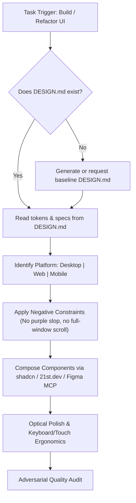

---
name: anti-slop-ui-design
description: Design and implement high-taste, anti-AI user interfaces across Desktop, Web, and Mobile. Enforces design contracts (DESIGN.md), neutral color systems (OKLCH/Zinc), typographic hierarchy, platform-native viewports, and integrations with 21st.dev, shadcn, and Figma MCP.
---

# Anti-Slop UI/UX Design Engineering Skill

Use this skill when designing, reviewing, or implementing user interfaces for **Desktop** (Tauri, Electron, Native), **Web** (React, Next.js, Vue, SaaS), or **Mobile** (React Native, Flutter, iOS/Android). It prevents generic AI tropes (purple gradients, Inter default, full-page scroll on desktop, sparkle badges) and enforces production-grade human design taste.

---

## 1. Core Workflow: The Design Contract Protocol

When tasked with generating or modifying UI components:

### Step 1: Ground in `DESIGN.md`
- Inspect `DESIGN.md` in the project root before writing inline CSS or utility classes.
- If `DESIGN.md` does not exist:
  - Generate a clean baseline contract or recommend pulling tokens from `designmd.directory` (e.g., Linear, Raycast, Vercel themes) or running `cssdna.com` on reference software.
  - Define: Base background, 2 surface layers (3–5% contrast delta), 1px border tokens (`border-white/10` or `border-zinc-200`), text primary/secondary/muted, and exactly **1 functional solid accent color**.

### Step 2: Enforce Negative Constraints (Anti-AI Slop)
- **Banned Colors:** Do NOT use `indigo-500`, `purple-600`, `violet-500`, or purple-to-blue gradients.
- **Banned Typography Habits:** Do NOT differentiate hierarchy by size alone. Use `font-medium`/`font-semibold`, `tracking-tight` on headings, and tonal contrast (`text-zinc-900` vs `text-zinc-500`).
- **Tabular Figures:** Always apply `tabular-nums` (`font-variant-numeric: tabular-nums`) to all tables, price tags, timestamps, and metric cards.
- **Banned Ornaments:** Eliminate fake terminal title bars, glowing badge stars, and rainbow card borders.

---

## 2. Platform Adaptation Rules

### Desktop Applications (Tauri / Electron / Native)
1. **Fixed App Shell:** Root window must have `h-screen` (`100vh`) and `overflow-hidden`. The overall window must NEVER scroll like a webpage.
2. **Internal Scrolling:** Place `overflow-y-auto` strictly inside designated content panes, file lists, or data tables.
3. **High Density:**
   - Body font: `12px–13px` (`0.8125rem`).
   - Button heights: `28px–32px` (`h-7` or `h-8`).
   - Padding & gaps: `8px–12px`.
4. **Desktop Navigation:** Collapsible left sidebar + Command Palette (`Cmd/Ctrl + K`) + full keyboard accessibility (`Tab`, `Esc`, arrow navigation). Never insert a marketing website footer.

### Web Applications (SaaS / Dashboard / Portals)
1. **Layout Strategy:** Fluid document scroll for landing/marketing pages; bounded split shell (`max-w-7xl` container) for dashboard views.
2. **Medium Density:**
   - Body font: `14px–16px`.
   - Button heights: `36px–40px` (`h-9` or `h-10`).
   - Whitespace: `16px–24px`.
3. **Web Navigation:** Top navbar or left sidebar, breadcrumbs matching page routes, deep-linkable URLs.

### Mobile Applications (React Native / Flutter / Native)
1. **Viewport & Safe Area:** Single-column layout with mandatory Safe Area Insets for status bar, notch, dynamic island, and bottom home indicator.
2. **Touch-First Density:**
   - Body font: `15px–16px` (prevents iOS form auto-zoom).
   - Minimum touch target: `44x44px`.
3. **Mobile Ergonomics:**
   - Bottom Tab Bar (max 4–5 items).
   - Use **Bottom Sheets** for detail previews or filters; avoid centered desktop modal dialogs.
   - Interactive feedback: `active:scale-[0.97]` and native haptic triggers.

---

## 3. Curated Typeface Pairings

Replace generic default Inter/Roboto with modern, characterful alternatives:

| Use Case | Primary Interface Font | Monospace / Data Font |
| :--- | :--- | :--- |
| **Technical & Desktop Dashboards** | *Geist Sans*, *Plus Jakarta Sans*, *Switzer*, *General Sans* | *Geist Mono*, *JetBrains Mono* |
| **Editorial & Consumer Products** | *Instrument Sans*, *Satoshi*, *Cabinet Grotesk* | *Geist Mono* |

---

## 4. MCP Server Integration Guidance

1. **21st.dev MCP (`21st.dev/mcp`):** Use when discovering curated, human-crafted component implementations rather than generating boilerplate components from scratch.
2. **shadcn/ui MCP (`ui.shadcn.com/docs/mcp`):** Run `npx shadcn@latest mcp` to pull tested accessible primitives (Radix/Base UI) with custom theme variables.
3. **Figma Official MCP (`mcp.figma.com/mcp`):** Inspect designer tokens, frames, and use `code-to-canvas` to send live React/HTML previews back to Figma for visual design review.

---

## 5. Adversarial Verification Checklist

Before completing UI implementation, run this checklist:
- [ ] Window scrolling is locked with `overflow-hidden` on desktop.
- [ ] Font hierarchy uses weight, tracking, and tone—not just huge size jumps.
- [ ] Monospaced numbers (`tabular-nums`) are applied to all metrics/tables.
- [ ] Color palette is grounded in neutral scales (Zinc/Slate/OKLCH) with at most 1 functional accent.
- [ ] Button heights match platform density (`28-32px` desktop, `36-40px` web, `44px` mobile).
- [ ] Keyboard navigation (`Tab`, `Esc`, `Enter`) works without trap.

