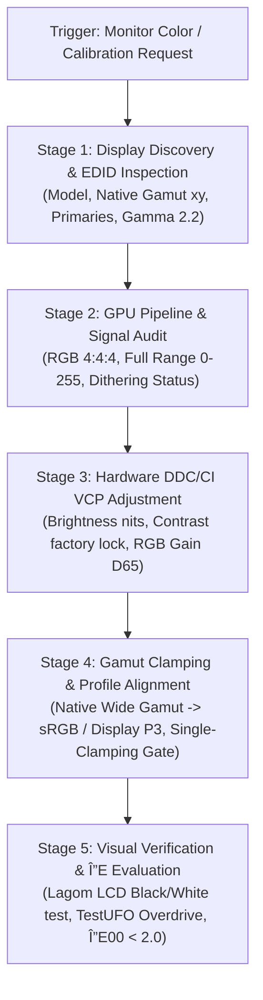

---
name: display-color-calibration
description: Audit, calibrate, and optimize computer monitor hardware and color accuracy via DDC/CI VESA MCCS, EDID chromaticity parsing, CIEDE2000 ΔE calculation, gamut clamping (sRGB/DCI-P3), and GPU signal integrity.
---

# Display Color Calibration & Monitor Hardware Optimization Skill

Use this skill whenever the user requests monitor color adjustment, color accuracy analysis, wide-gamut clamping, white point calibration, or hardware monitor tuning via DDC/CI on Windows or macOS.

Enforces **Deterministic Colorimetry & Hardware-First Calibration**:
1. **Hardware-First Hierarchy**: Tune monitor physical registers (OSD / VCP Gain, Brightness, Contrast) before touching GPU LUTs or OS software profiles.
2. **Anti-Double-Clamping Invariant**: Strictly prevent simultaneous active gamut clamps (e.g., monitor sRGB mode + `novideo_srgb` / Windows ACM).
3. **GPU Signal & Banding Protection**: Enforce RGB 4:4:4 Full Range (0–255) and GPU Blue-Noise / Temporal Dithering when applying calibration LUTs.
4. **Verified Colorimetric Math**: Zero-hallucination CIEDE2000 ($\Delta E_{00}$) calculation and EDID chromaticity parsing via dedicated script `monitor_color_tool.py`.

---

## 1. 5-Stage Deterministic Calibration Workflow



---

## 2. Mandatory Color Steering Invariants

Every calibration recommendation and automation run **MUST ENFORCE THIS CHECKLIST**:

| Checkpoint | Invariant Rule | Failure Risk / Symptom |
| :--- | :--- | :--- |
| **RGB Gain Adjustment** | **Never raise any RGB channel above factory default (100)**. Always attenuate the dominant channel(s) downward to reach D65 ($x=0.3127, y=0.3290$). | Raising gain causes digital ADC clipping $\rightarrow$ severe white crushing on highlight tones (levels 250–255). |
| **Contrast Setting** | **Keep Contrast at factory default (typically 50 or 70)** unless white test pattern reveals crushing. | Raising contrast clips near-white; lowering contrast collapses panel static dynamic range and contrast ratio. |
| **Gamut Clamping** | **Single Clamping Layer Only**: If monitor OSD is set to sRGB mode, DO NOT enable GPU clamping (`novideo_srgb`, `dwm_lut`) or Windows ACM. | Compounding clamps creates double-clamping $\rightarrow$ washed out, dull, lifeless colors. |
| **SDR vs HDR** | **Strictly isolate pipelines**: SDR targets sRGB / Gamma 2.2 / 100–140 nits. HDR targets Rec.2020 container / ST 2084 PQ. | SDR content viewed with HDR enabled without ACM looks washed out or blown out. |
| **GPU Dithering** | **Enforce Dithering whenever LUTs are applied on 8-bit / 8-bit+FRC panels**. | Inverting or correcting LUTs in an 8-bit GPU pipeline without dithering induces visible posterization (color banding). |
| **Overdrive Tuning** | **Adjust response time / overdrive to matched framerates**. Never recommend maximum/extreme overdrive when FPS is locked below max Hz. | High overdrive with lower FPS creates violent inverse ghosting (bright corona trails around moving edges). |

---

## 3. Dedicated CLI Execution Tool: `monitor_color_tool.py`

Execute operations deterministically via the local tool in `tools/monitor_color_tool.py`:

```bash
# 1. Full system display audit (EDID, active monitors, current VCP values)
python tools/monitor_color_tool.py audit

# 2. Inspect EDID chromaticity coordinates & gamut coverage
python tools/monitor_color_tool.py edid

# 3. Read current hardware VCP registers via DDC/CI
python tools/monitor_color_tool.py vcp-get --monitor 0

# 4. Safely adjust hardware brightness or RGB gain (Hardware-First)
python tools/monitor_color_tool.py vcp-set --monitor 0 --code 0x10 --value 25

# 5. Calculate CIEDE2000 (ΔE00) difference between measured and target colors
python tools/monitor_color_tool.py delta-e --target-lab 50,0,0 --sample-lab 51,1,-1
```

---

## 4. Visual Verification Patterns

Direct the user or guide visual verification using standard reference tests:
- **Black Level (Lagom LCD):** Squares 1–20 must be distinguishable from background black 0.
- **White Saturation (Lagom LCD):** Checkerboards 251–254 must remain visibly textured against white 255.
- **Gamma Calibration (Lagom LCD):** Verify smooth blend at Gamma 2.2 line across R, G, B channels.
- **Motion Clarity (Blur Busters TestUFO):** Observe alien UFO spaceship trails; eliminate inverse ghosting halos by stepping down Overdrive.

