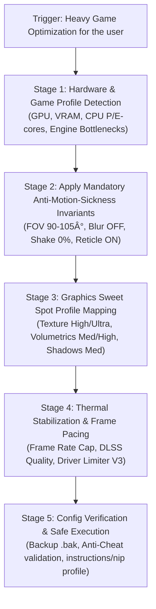

---
name: windows-gaming-optimizer
description: Optimize heavy Windows games (RDR2, Space Marine 2, Warhammer 3, Witcher 3, etc.) for high visual fidelity without PC thermal exhaustion, enforcing zero-nausea anti-motion-sickness ergonomics (FOV 90-105°, Motion Blur Off, Camera Shake 0%, Frame Pacing).
---

# Windows Heavy Gaming Optimizer & Anti-Motion-Sickness Skill

Use this skill whenever the user requests analysis, optimization, or performance tuning for demanding Windows PC games (such as *Red Dead Redemption 2*, *Space Marine 2*, *Total War: Warhammer 3*, *The Witcher 3 Next-Gen*, etc.).

Enforces **Pareto Efficiency ("Sweet Spot")**:
1. **High Visual Fidelity ("Anti-Burik")**: Sharp textures, clean anti-aliasing via DLSS/XeSS/FSR Quality, preserved ambient occlusion depth.
2. **Thermal & Hardware Protection ("Anti-Panas")**: Cut wasteful GPU/CPU compute, lock frametime, lower power consumption (Watts) to prevent room overheating and fan noise.
3. **Zero-Nausea Ergonomics**: Eliminate motion sickness triggers (narrow FOV, motion blur, camera shake, head bobbing, micro-stuttering).

---

## 1. 5-Stage Deterministic Optimization Workflow

---

## 2. Mandatory Persona Invariants (Anti-Motion-Sickness)

Every generated configuration profile **MUST ENFORCE THIS CHECKLIST**:

| Parameter | Target Value | Ergonomic / Physiological Rationale |
| :--- | :--- | :--- |
| **Field of View (FOV)** | **90° – 105°** | Prevents tunnel vision / fishbowl distortion at PC desktop viewing distances. |
| **Motion Blur** | **OFF (0% / Disabled)** | Eliminates rotational camera blur causing vestibular-ocular sensory mismatch. |
| **Camera Shake / Recoil** | **OFF / 0%** | Prevents rapid visual readjustment strain during explosions and gunfire. |
| **Head Bobbing / Sway** | **OFF / 0%** | Eliminates screen bounce during locomotion, the primary rapid trigger for nausea. |
| **Frame Rate Cap** | **Locked Stable (60/75/90)** | Prevents micro-stuttering and irregular frametime spikes causing disorientation. |
| **Chromatic Aberration** | **OFF** | Removes edge color fringing that induces eye strain and visual fatigue. |
| **Depth of Field (DoF)** | **OFF / Minimal** | Keeps background scenery sharp, allowing eye muscles to relax. |
| **Center Crosshair / Dot** | **ON (If supported)** | Provides a persistent visual anchor point for brain spatial reference. |

---

## 3. Thermal & Power Management Strategy ("Anti-Panas")

Severe room heat occurs when GPU/CPU runs unconstrained at 99–100% TDP:
1. **Frame Rate Capping**:
   - Calculate stable frame target: For 60Hz displays, lock at **60 FPS** (or **58 FPS** with VRR/G-Sync).
   - If GPU delivers 80–100 FPS erratically, lock at **72 FPS** or **75 FPS**.
   - **Impact:** GPU utilization drops from 99% to ~70%, cutting **40W–80W** of heat dissipation into the room.
2. **Prioritize DLSS / XeSS / FSR Quality**:
   - Rendering at a clean internal resolution with AI upscaling yields sharper results than native TAA while reducing shader load by 30%.
3. **P-Core Affinity (Intel Hybrid / AMD Multi-CCD)**:
   - Pin game threads to Performance Cores to eliminate scheduler stutter from E-cores.

---

## 4. Graphics Settings Hierarchy ("Anti-Burik")

1. **NEVER REDUCE**:
   - `Texture Quality`: Keep **High** or **Ultra** while VRAM headroom $\le 90\%$.
   - `Anisotropic Filtering`: Keep **16x** (0% performance cost, sharp surface detail).
   - `Ambient Occlusion`: Keep **Medium/High** (prevents flat, floating visuals).
2. **TRIM FROM ULTRA TO HIGH/MEDIUM**:
   - `Volumetrics (Fog/Cloud/Lighting)`: Drop to **Medium/High** (saves 15–25% GPU compute).
   - `Shadow Quality & Contact Shadows`: Drop to **High/Medium** (Ultra offers negligible fidelity gain).
   - `Water Reflections & Physics`: Lower to **25%–50% / Medium**.
   - `Ray Tracing`: Disable if room temperature elevates, unless using DLSS Frame Generation on RTX 40 series.

---

## 5. Config Locations & Open-Source Tool References

1. **Ludusavi Manifest** (`mtkennerly/ludusavi-manifest`):
   - Use YAML schema to map save/config paths across Steam, GOG, and Epic in `%APPDATA%`, `%LOCALAPPDATA%`, or `%USERPROFILE%\Documents`.
2. **PCGamingWiki Cargo API**:
   - URL: `https://www.pcgamingwiki.com/w/api.php?action=cargoquery&tables=GameData...`
   - Retrieve automated fields for: FOV slider limits, config paths, upscaling support, and frametime fixes.
3. **NVIDIA Profile Inspector**:
   - CLI parameter: `nvidiaProfileInspector.exe -silentImport "Profile.nip"`.
   - Enforce Resizable BAR, *Frame Rate Limiter V3*, and DLSS profiles at driver level.
4. **Safety Guards**:
   - Always create a `.bak` copy of configuration files before modifying.
   - Never inject custom DLLs into games with active Anti-Cheat (Easy Anti-Cheat, BattlEye, Ricochet).

